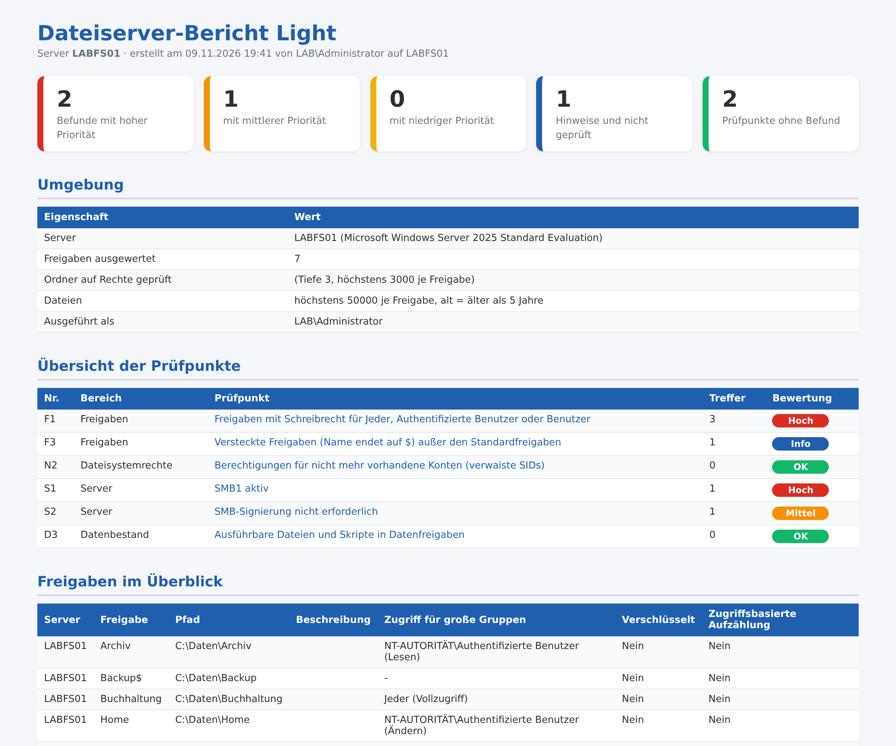

# Dateiserver-Bericht Light – Freigaben und Rechte auf Windows-Dateiservern prüfen

Kostenloses PowerShell-Skript: prüft Freigaben, Dateisystemrechte und Servereinstellungen von Windows-Dateiservern in **6 Punkten** und erzeugt einen übersichtlichen **HTML-Bericht auf Deutsch**. Es arbeitet **ausschließlich lesend**: Es ändert nichts, legt nichts an und überträgt keine Daten.



Der gezeigte Bericht stammt aus einer Testdomäne. Das vollständige Beispiel liegt als [Beispielbericht.html](Beispielbericht.html) bei.

## Was geprüft wird

| Nr. | Bereich | Prüfpunkt |
|---|---|---|
| F1 | Freigaben | Freigaben mit Schreibrecht für Jeder, Authentifizierte Benutzer oder Benutzer |
| F3 | Freigaben | Versteckte Freigaben (Name endet auf $) außer den Standardfreigaben |
| N2 | Dateisystemrechte | Berechtigungen für nicht mehr vorhandene Konten (verwaiste SIDs) |
| S1 | Server | SMB1 aktiv |
| S2 | Server | SMB-Signierung nicht erforderlich |
| D3 | Datenbestand | Ausführbare Dateien und Skripte in Datenfreigaben |

Jeder Befund kommt mit Erklärung und Empfehlung.

## Start

```powershell
powershell -ExecutionPolicy Bypass -File .\Dateiserver-Bericht-Light.ps1
```

Alle Optionen zeigt `Get-Help .\Dateiserver-Bericht-Light.ps1 -Detailed`. Voraussetzungen und Rechte stehen im Kopf des Skripts. Getestet mit Windows Server 2019, 2022 und 2025 in Testdomänen (deutsches Windows).

## Vollversion

Die Light-Version enthält 6 von 24 Prüfpunkten (25 %). Die **Vollversion** prüft zusätzlich unter anderem:

- Freigaben auf ein ganzes Laufwerk oder einen Systemordner
- Freigaben ohne zugriffsbasierte Aufzählung
- Freigaben mit fehlendem Ordner
- Schreibrecht für Jeder, Authentifizierte Benutzer oder Domänen-Benutzer
- Schreibrechte direkt an einzelnen Benutzerkonten
- Ordner mit abgeschalteter Vererbung
- Vollzugriff für Benutzer oder Gruppen außer Administratoren
- Ordner mit einem einzelnen Benutzer als Besitzer
- Freigaben ohne Anmeldung erreichbar (Null-Sitzungen)
- Lokales Gastkonto aktiviert
- Volumes mit Freigaben fast voll
- Volumes mit Freigaben ohne Schattenkopien
- Kein Ressourcen-Manager für Dateiserver installiert
- Betriebssystem ohne oder bald ohne Support
- Dateien, die seit über N N nicht geändert wurden
- Sehr große Dateien (ab N GB)
- Dateinamen mit Hinweis auf Zugangsdaten
- Sehr lange Pfade (ab 240 Zeichen)

➜ **[Vollversion auf Gumroad](https://mueller86.gumroad.com/l/wbbwj)** · **[Vollversion auf Etsy](https://www.etsy.com/listing/4612420692)** · **[alle Prüfskripte im Shop](https://www.etsy.com/shop/ITAdminToolsbyMM)**

## Hinweise

- Der Bericht enthält Konto-, Rechner- oder Servernamen – bitte vertraulich behandeln.
- Der Bericht zeigt Auffälligkeiten anhand fester Regeln. Er ersetzt keine Sicherheitsprüfung und erhebt keinen Anspruch auf Vollständigkeit.
- Nutzung auf eigene Verantwortung, siehe [LICENSE](LICENSE).
- Bei der Ausarbeitung wurden KI-Werkzeuge unterstützend eingesetzt; Inhalte und Skript wurden fachlich geprüft und im Testlab getestet.

---

### English

Free, read-only PowerShell script that checks shares, NTFS permissions and server settings of Windows file servers (6 checks, German HTML report with findings and recommendations). No changes are made and no data leaves the machine. Run: `powershell -ExecutionPolicy Bypass -File .\Dateiserver-Bericht-Light.ps1`. The full version with 24 checks: https://mueller86.gumroad.com/l/wbbwj
